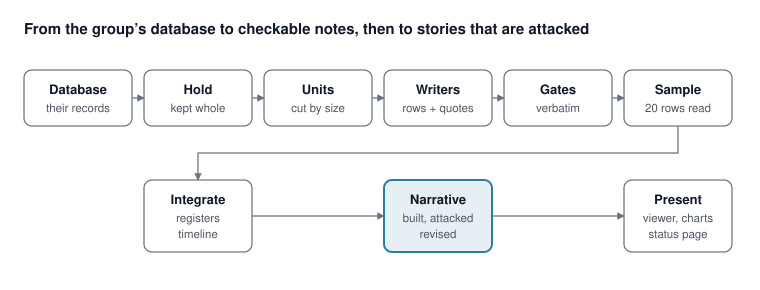
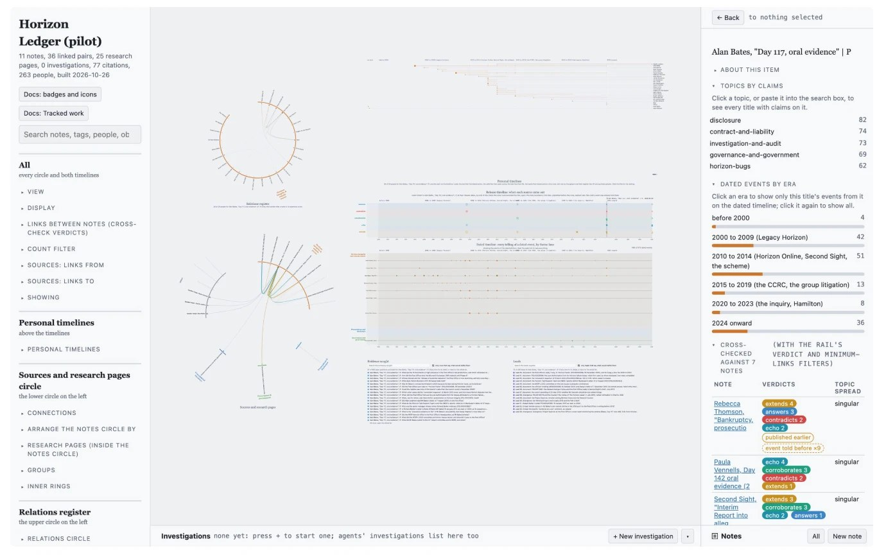
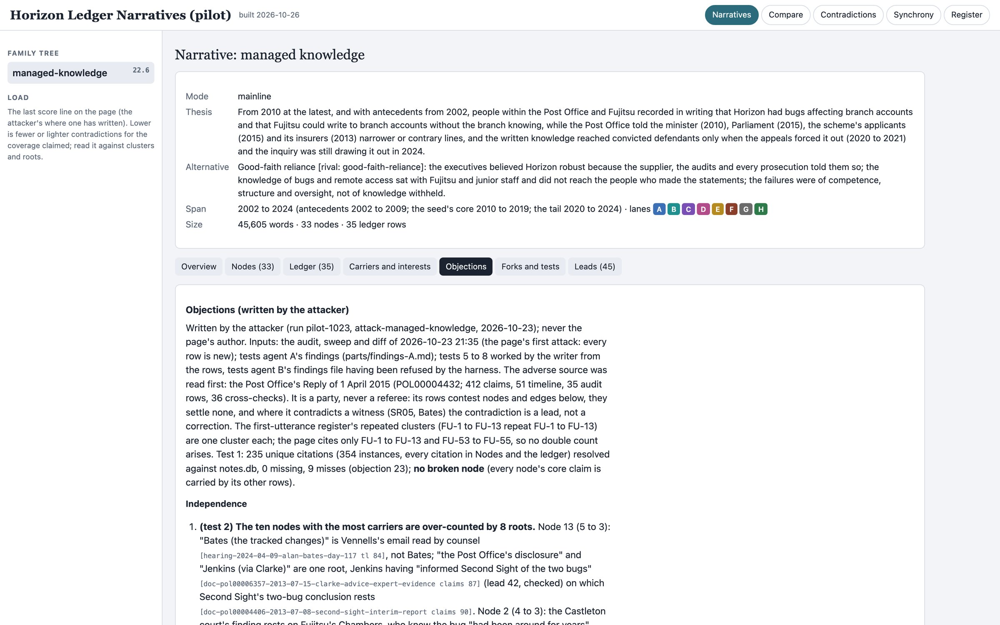
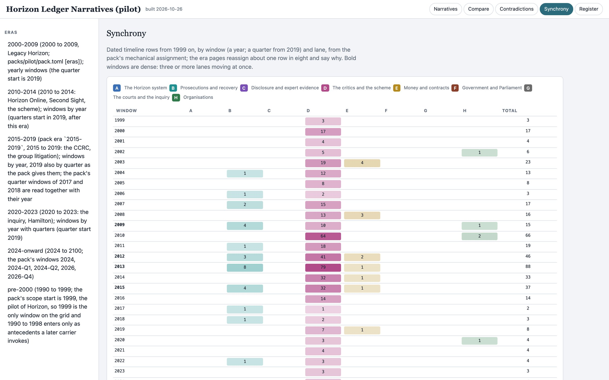
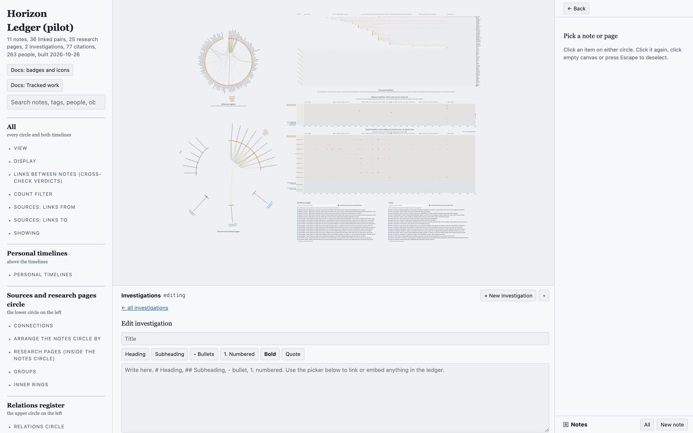
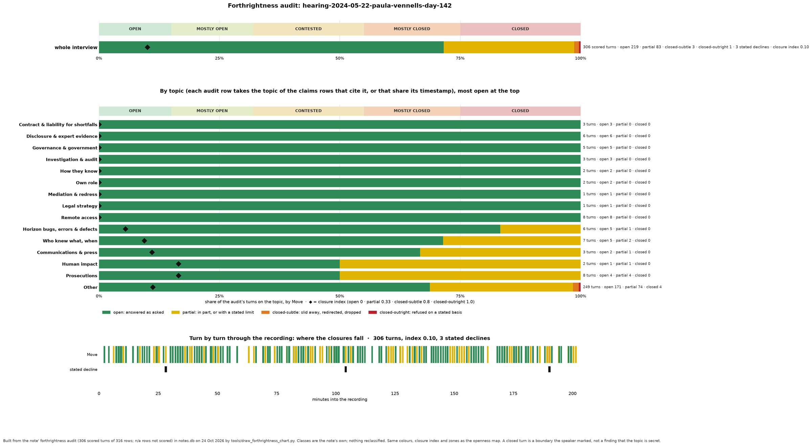
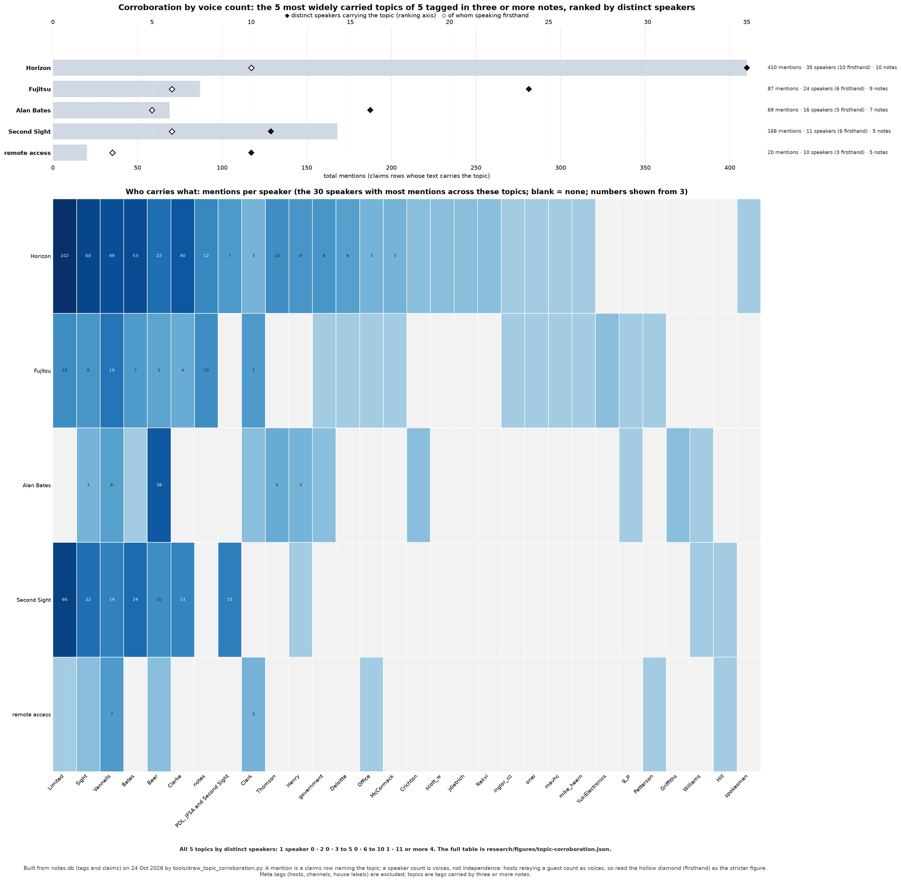

# Parsing disinfo with OSINT and LLMs

October 2026

## The problem

A research group studying disinformation in a contested public record holds hundreds of sources in its own database: hearing transcripts, exhibits, judgments, press pieces, videos, and forum threads. The record is contested because people inside it had reasons to shape it. 

The same line appears through many mouths; a hedge drops out of a paraphrase; a report's flat assertion about another party is carried forward as if a witness had seen it; a question is answered with a wall that reads like an answer; a late telling is presented as the first; and a circle's line circulates with no party attached to it. 

A summary loses the words and the basis. A search returns passages without a record of what was asked and declined. A large language model reading sources whole quotes a third of its citations inexactly. None of these can be handed to a reviewer, and none can be attacked. 

To parse disinformation, question is not only what happened but who said what, when, on what basis, and in whose interest.

## The solution

Our tool-suite turns a database of sources into markdown notes that a court could check, and then into stories that can be attacked. Every assertion in a story traces to a row, every row to a speaker and a chain of custody, and every speaker to the circle and party they stand with. 

Setup reads the database and proposes a mapping, holds every record with its text and provenance, and cuts each source into units. One writer per unit range rows every claim with its speaker, class, move and chain of custody, pasting every quotation from a tool that reads the source by line; a second writer builds the other sections from the finished ledger; script gates refuse a quotation that is not verbatim or a pointer that does not hold its words; a sampled reading measures what the gates cannot see. 

Integration refreshes the registers of people, organizations and relations, the dated timeline and the first-telling record, and the presentation writes the viewer, the charts and the status page as local files. 

A narrative is then built from the held rows under a disinformation lens, attacked by a second agent who argues the other side from the adverse sources, and revised on the record. Every agent runs on Claude Code against the group's own model route, and nothing leaves the project folder.

The final product combines three things: 

1. The **methods and systems** are the backbone of ledger: the rows, the registers, the audits, the lens and the narrative suite ([The methods behind the narrative suite](#the-methods-behind-the-narrative-suite)). 
2. The **manual portion** is for the researchers' own work alongside the model's: the map, the leads register, the evidence sought and the investigation pages ([Working by hand](#working-by-hand-the-map-leads-evidence-and-investigations)). 
3. The **product** ships as an LLM-native Claude Code plugin installed by pasting one message, a setup dialogue in plain language that writes the group's own pack, and a viewer, charts and status page built automatically after every intake, under [From method to product](#from-method-to-product) and [Try it](#try-it).

The top row is one intake; the bottom row runs after every integration, and the narrative is the part a second agent attacks.

The map is the whole ledger on one page: the relations register as a circle of people, the sources and research pages as a second circle, a personal timeline for every person, the release timeline, the dated timeline of every telling by lane, and below them the open questions and the leads. Pinning one source filters everything else to it. 

The worked example throughout is the Post Office Horizon IT Inquiry, the UK public inquiry into the Post Office's prosecution of subpostmasters on evidence from the Horizon accounting system. Here one of its hearing days is pinned, and the rail shows its topics by claims, its dated events by era, and the seven notes it was cross-checked against with the verdicts.

## The methods behind the narrative suite

The narrative suite is the last stage, and everything before it exists to make it attackable. Each method below answers one way a record gets shaped.

### Rows, not summaries

Every claim in a source becomes a row: who said it, in which words, as what kind of statement (firsthand, hearsay, document, inference), with what move (asserts, denies, hedges, declines), and through which hands it reached the source. 

Firsthand is an act, not a status: a row is firsthand only where the speaker saw or did the thing. Hedges, bounds and qualifiers are kept in the row's own words. Every quotation is pasted from a tool that reads the source by line, and a script gate refuses a quotation whose words differ from the source by anything more than punctuation or case. 

The schema is written as a document a reviewer can read, with numbered rules and the cases that produced them.

### Who carries what

A telling is attached to the person who told it, and the person to the circles and parties they belong to: the subpostmasters, the executive and board, the supplier's engineers, the lawyers, the investigators, the shareholder and ministers, the press and campaigners, the public forum. Four intake rules keep the corpus from becoming one circle's echo:

- **Earliest telling first.** No later telling of a claim enters without a search for its earliest public telling, and the earliest enters with it. A first-telling register clusters claims by their first appearance, and a dated threshold (in the Horizon example, Computer Weekly's investigation of May 2009) marks which tellings predate the public story.
- **One adverse source per circle per era.** For every circle and every era the corpus holds at least one dated adverse telling, taken in under the same schema and the same audit as any other. Adversity is a class, not a discount.
- **A new carrier must add a root, not a mouth.** A relay of a held root enters only as an earliest telling or as a divergence. The intake report says which roots a note adds and which it merely relays.
- **Leaks and citations carry their chain.** A leaked document is hearsay with the leaker as its root until an official release matches it. A source's own citations are verified and recorded, never rowed as the cited work's claims.

### Where tellings diverge

When two sources tell the same event differently, both tellings are recorded and the divergence is tallied by party. An official body's version is never applied as a correction to a witness; the gap becomes a lead with the test that would separate error from misdirection. 

An echo tool reads the held rows for the same wording and the same rare details across mouths that look independent, against a list of the record's stock phrases, so a line that travelled through a circle is not counted as corroboration. 

A synchrony page lays the dated rows out by window and lane, so the months in which several lanes move at once can be read against the stories that claim to explain them.

### What a speaker declines

Every hearing or interview on an audited subject carries a forthrightness audit. Each turn is scored as answered as asked, answered in part or with a stated limit, slid away from, or refused on a stated basis, and the stated declines are listed with their grounds. 

A chart is built for every audited recording, pooled by speaker and by topic; one hearing day's is shown under the measurements. 

The audit is read under one rule: a closure is a wall, not a denial, and never evidence for the content behind it. Open speakers may be wrong or serving an agenda; closed speakers may want the truth out and be unable to say it. 

The audit tells a narrative which walls it predicts, and nothing more.

### The disinformation lens

A catalogue of 27 techniques, each attributed to the public source that stated it, gives a narrative builder a vocabulary for how a record is shaped: techniques, the operative moves that carry them, and the exculpatory readings that explain them away. 

Each technique has a parameter slot for the subject, a general qualification, and, where the held rows can test it, one of six database tests that look for counterexamples: a control-side speaker whose claims an independent route corroborates, a disclosure-side speaker who denies the central claim, and the like. Weighting rules say when a row is discounted (its speaker or its first chain segment sits on the control side) and when it is weighted. 

A group adds its own lens as an instance: the Horizon example drew fifteen techniques from the Serious Fraud Office's published guidance on corporate cooperation and mapped them onto the catalogue. 

A codebook holds the record's argot and code names, and a decode is a lead, never a finding, until a second channel or a dated key corroborates it.

### Building a narrative

A narrative states one thesis as a dated causal story: an ordered set of nodes spanning at least two lanes, each node carrying its independent roots and a basis (document, record, recollection, inference or press), with an explicit stance on every contradiction the story touches. A rival sheet states the strongest alternative, and the page's thesis cites it. 

A contradiction that a test could separate into error or misdirection is marked a flare and written to the leads register with that test. The page is scored on five axes and never on a composite:

| Axis | What it measures |
| --- | --- |
| Coverage | the clusters and rows explained, and the independent roots after chain, host-loop and echo collapse, given twice: as flagged, and with one root per circle |
| Contradiction load | the weighted sum over the ledger: core or periphery, independent parties or the same line, and how much of the story sits downstream of each |
| Openness fit | the walls the story predicts, over the walls in the audits, with ordinary grounds excluded and stated |
| Interest alignment | the roots unaffiliated with any party the story benefits, over all roots; affiliation flags and never excludes |
| Tests | the finite tests the page names with a place to look; a story with none is not yet a narrative |

A story that claims little has few contradictions, so load is always read against coverage, and the viewer says so on every page.

### Attacking it, and revising on the record

A second agent attacks the page from the adverse sources. Its tests include the closures subset, the interests of every root, a deflationary reading built from the rival sheet, whether the named tests can be run and which the held rows already answer, a basis audit that recomputes every node's basis from its rows and counts the thin nodes, an unused-rows check that reads every held row the page never cited, and an adoption check on the revision table. 

Objections go on the record. A reviser verifies an objection's own rows before adopting it; an objection whose rows do not support it is declined with the rows named. 

Forks carry the parent's corrections before rebuilding, name one reading of the fork node, and are ranked by the anomalies they absorb and the discriminating tests they name, never by load.

## Seeing it: the narrative viewer

The viewer is one self-contained page, built automatically after every integration and opened from the project folder. It has no server and no dependency outside the file. Every cell that rests on a row shows the row's pointer, and the pointer opens the row. 

The five views are Narratives, Compare, Contradictions, Synchrony and Register.

The design choices are the method's. Lanes keep one color across every page. A family tree on the left holds the mainline and its forks with their scores. The score line's reading rule sits beside it, so a clean-looking page is read against its coverage. Tables carry the pointer form the agents use, so a reader who finds a fault can name the row in the same words the next intake brief will use.

## Working by hand: the map, leads, evidence and investigations

The narrative suite is the model's output. The map shown under What the ledger does is for the group's own work alongside it, and it was built and used by hand before any of it was wrapped as a product. 

Two registers at the foot of the map are where a researcher works from day to day.

Below the timelines sit the two registers a researcher works from. 

Evidence sought lists every open question the intakes raised, with the checkbox that keeps only the rows that say what would settle them. 

Leads lists the register: documents to obtain, divergences to resolve and threads to follow, each with its status and the test that closes it.

An investigation is a page a person writes in the map, with a picker that links or embeds anything in the ledger. The protocol it follows is modeled on the best independent investigative writing: the question stated as a choice between live explanations, the strongest alternative tested before any common cause, every assertion quoted or row-cited, the teller's own limit quoted, and a finite list of tests. 

An evidence pack tool gathers everything the ledger holds on a thread to start one.

## The measurements

The shipped intake form was chosen by measurement, not by preference: six forms were run on the same two sources and read twenty rows at a time against the source, judging each row on five points (verbatim, support, grain, class and move, chain). 

A fault of meaning is a row a reader would take wrongly; a formal fault leaves the meaning intact.

| Intake form | Faults of meaning in 40 rows | Quotations with changed words | Cost for the two sources |
| --- | --- | --- | --- |
| One agent, the whole source in its context, curated notes | 0 | 34% and 50% | not measured |
| One agent with the gates after it | 2 | 51% and 57% | 165M |
| Staged: a reader's digest, then two writers | 5 | 0% | 224M |
| Staged plus a full checking pass | 3 | 0% | 261M |
| Unit writers: the unit in the writer's context, then gates | 1 | 0% | 169M |
| Unit writers under the final briefs, the confirming run | 2 | 0% (989 quotations) | 164M |
| One agent under a quotation obligation, the confirming run | 6 | 0% (684 quotations) | 183M |

The single agent reads meaning well and cannot be made to quote; the pointer forms quote exactly and err at the hand-off between reader and writer. Unit writers remove that hand-off at three quarters of the staged form's cost. Costs are cache-read tokens counted by API record; on the pilot corpus that came to about 3 to 7 million per 1,000 source words, 0.3 million per claims row, and 1.0 billion for eleven sources of 171,000 words.

**Where the faults of meaning come from.** Twenty-two faults across the pilot and the same-source runs fall into three clusters, which became three rules in the briefs and the checker's order of attention.

| Cluster | Faults | What the passages have in common |
| --- | --- | --- |
| A document's flat assertion classed as the author's own observation | 13 | reports, replies and advice stating facts about other parties with no source named |
| A hedge, bound or qualifier lost in paraphrase or cut from a quotation | 5 | earliest, only, appear, suggested, unless, as practiced |
| The wrong actor or teller in a passage with two | 5 | a pronoun, a document read out, an email, a comment on a comment |

**What an intake leaves behind.** Two readings come out of the intake itself and are read before any narrative is built. The forthrightness audit scores every turn of a hearing or interview, by topic and turn by turn through the recording. Corroboration by voice count separates mentions from distinct speakers and from firsthand speakers, and shows who carries each topic.

**How close the method came to the record.** The worked example is the Post Office Horizon IT Inquiry, whose foundation is three court judgments: Bates v Post Office (No 3) and (No 6) of 2019 and Hamilton v Post Office of 2021. The ledger held them as canon and never rowed them, so they served as the yardstick: two readers scored the narrative page's 33 nodes against them.

| Against the three judgments | Nodes |
| --- | --- |
| Contradicted | 0 |
| Confirmed, and the court found more | 10 |
| Partly: found in part, or on another basis or date | 14 |
| Not addressed by the judgments | 10 |

On direction the page was never wrong; on dates it ran late wherever its eleven sources were late, and one avoidable miss sat in a held row the page never cited, which produced the unused-rows check. The page declined to decide any individual's state of mind, and so did both courts.

## From method to product

A method a group cannot run is a paper. The ledger ships as a Claude Code plugin with eight skills, and a researcher never edits a brief or a config file by hand.

| Skill | What the researcher does | What happens |
| --- | --- | --- |
| `/ledger:install` | pastes one message from the repository into Claude Code in an empty folder | the plugin installs, the environment builds from bundled wheels (offline if need be), and it stops before setup |
| `/ledger:setup` | answers questions in plain language, one stage at a time | the group's pack is written: question, who the inquiry protects, the people to follow, the circles and their adverse sources, the eras, the known playbooks, the canon texts, members, model route and budget |
| `/ledger:intake` | points at a folder of sources or the group's database | units are cut, writers row every unit, gates check every quotation and pointer, a sample is read, and the registers, timeline and viewer refresh |
| `/ledger:narrate` | names a thesis | a narrative page is built from the held rows under the lens, scored on the five axes |
| `/ledger:attack` | names a page | a second agent runs the tests and files objections; a reviser answers them on the record |
| `/ledger:report` | asks | the status page, the cost log and the open leads, as files |
| `/ledger:status` and `/ledger:settings` | asks, or changes a setting | what is held, what is queued, what it cost; the model route and budget |

The setup dialogue was rewritten until a project manager with no knowledge of the method could answer it. Its first question is the account's privacy settings; its longest explains what following one person across every source gains, before asking who should get such a record. 

Every stage writes a dated ruling table into the project, so a later member can read why the pack is as it is. Every agent brief is a template the plugin renders from the pack, so the group's vocabulary, circles and rules reach every intake without anyone retyping them. 

The presentation is automatic: after each integration the viewer, the forthrightness charts, the corroboration chart and the status page are rebuilt as local files, and the cost of every run is logged in the units the group is billed in.

## Why it is built this way

- **Scripts gate what a model cannot be trusted to do.** Quotations, pointers, unit coverage and item budgets are checked by code; the model is measured on what remains, by a sampled reading, and the measured rate is published with the method.
- **Everything is a local file.** Notes are markdown, the database is SQLite built from them, the viewer and charts are files in the project folder, and nothing leaves the folder but the model calls the group routes itself.
- **The domain is a pack, the method is the core.** Circles, eras, topics, lenses, canon texts, the codebook and the catalysts live in a pack the group writes during setup. The intake, audit, narrative and attack methods are the same for every record.
- **Toke efficiency.** Six intake forms were run on the same sources and read against them before one was shipped, and the cost model (calls times standing context) came from the measurements, not from the design.
- **Onboarding in plain language.** Setup asks the administrator and the project manager about their question, who the inquiry protects, which people deserve a record of their own, which circles and adverse sources exist, and which known playbooks of misleading techniques apply, in that order, and writes the pack. The first step is the account's privacy settings.
- **The record is the interface.** Every view shows the pointer a row has in the notes, so the agents, the viewer, the map and a reviewer's objection all name the same thing.

## The honest limits

- **The gates cannot see a fault of meaning.** They check words inside quotation marks, pointers and unit coverage; a paraphrase that reverses a hedge passes them. The sample reading, twenty rows per note read by a model at about 2 percent of an intake's cost, is the standing control, and a note past a threshold goes to a correcting pass before it integrates. The measured rate under the final briefs is 2 to 5 faults in 40 rows, not zero.
- **A ledger is only as early as its sources.** The courts, with the supplier's own records, put the first written bug reports six to eight years before the page's founding document. The method dates from the earliest telling it holds and says so; it does not guess earlier.
- **One note per 40,000 words.** A writer's context grows with the note it writes; a hearing day of 40,000 words reached 640,000 tokens of context. Longer sources are split into notes.
- **Cost is calls times context.** Cutting the reader's digest by half moved the writer's context by 6 percent; the cost sits in each agent's own output and standing reading, re-read on every call, and the split write is what brought it down.
- **Not verified in the handover build:** the Linux and Windows install branches, transcription of recordings, the plugin on another machine, and a provider route other than the build machine's. The handover document lists them, with the eleven known defects and their files.
- **The Horizon example names real people**, witnesses and executives who testified in public; the ledger records what they said, with citations, and a private-individuals rule governs anyone else.

## Try it

- **The demo:** the Horizon inquiry's narrative viewer, one self-contained page, at [oov-too.github.io/OSINT\_disinfo\_tool/demo/narratives-viewer.html](https://oov-too.github.io/OSINT_disinfo_tool/demo/narratives-viewer.html): 33 nodes, the contradiction ledger, the objections and the ruling.
- **The code:** [github.com/oov-too/OSINT\_disinfo\_tool](https://github.com/oov-too/OSINT_disinfo_tool), under the Apache License 2.0.
- **Set it up:** open Claude Code in an empty folder and paste the message in the repository's `BOOTSTRAP.md`; it installs the plugin, builds the environment, and stops before setup. Then `/ledger:setup` walks the administrator and the project manager through the question, the mapping of their own database, the rules, the people found, and the first intake. The handover document in the repository gives the rest.
